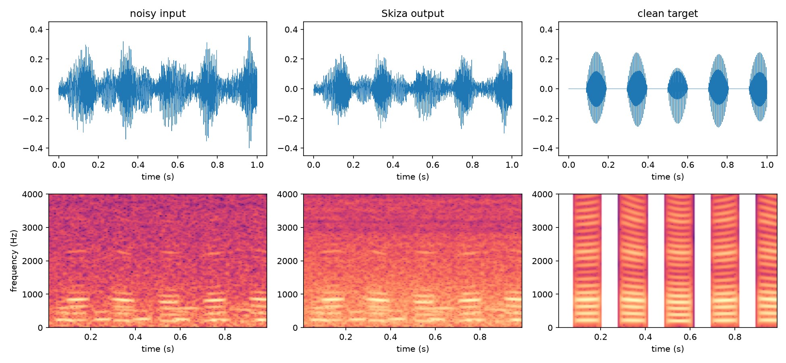
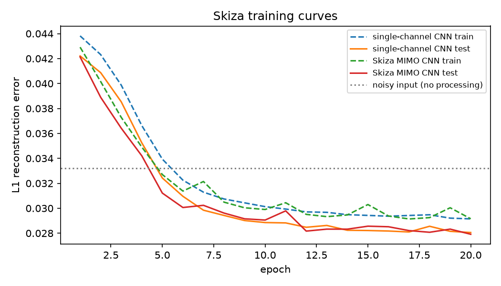

# Skiza — causal CNN speech denoising for affordable hearing devices

*Skiza* (Swahili: "listen") is the signal-processing core for low-cost
noise-cancelling headphones and hearing earpieces aimed at the Kenyan market.
It covers two use cases:

- **Sensory-friendly noise cancellation**, for people with autism and anyone
  who wants relief from loud environments such as matatu stages, markets and
  busy roads.
- **Clear amplification for Deaf and hard-of-hearing users**, where background
  noise and distortion make amplified speech hard to follow.

Premium ANC and hearing devices are out of reach for the common *mwananchi*(citizen). So the
model is kept very small: a **2-layer convolutional neural network with 400
parameters** that is small enough for the cheap microcontrollers and DSPs that
go into budget earbuds.



## Results

Reproduce these with `python -m skiza.train` (CPU, about 20 s). Each model was
trained on 250 noisy/clean audio pairs and evaluated on 50 held-out pairs.

| Model | Params | Train L1 | Test L1 |
|---|---:|---:|---:|
| Noisy input (no processing) | 0 | 0.03443 | 0.03321 |
| Single-channel CNN `[1,1,1]` (baseline) | 80 | 0.02915 | 0.02805 |
| **Skiza MIMO CNN `[1,5,1]`** | **400** | **0.02915** | **0.02791** |

The Skiza CNN **reduces L1 reconstruction error on the test set by 15.9%**
compared with the unprocessed noisy signal. Exact numbers are written to
[`results/metrics.json`](results/metrics.json) on every run.



Listen to a held-out test example: [`noisy.wav`](results/audio/noisy.wav),
[`skiza.wav`](results/audio/skiza.wav) and [`clean.wav`](results/audio/clean.wav).

## How it works

The model is a MIMO convolutional neural network written directly from the
shift-operator definition of convolution. Let `S` be the one-sample delay. Each
layer applies a multiple-input multiple-output filter and then a pointwise
`tanh`:

```
X_0 = X
X_l = tanh( sum_{k=0}^{K_l - 1}  S^k  X_{l-1}  H_{l,k} )      H_{l,k} ∈ R^{F_{l-1} × F_l}
```

- **Architecture:** 2 layers, features `[1, 5, 1]` and 40 taps per layer. The
  input is one microphone channel, the hidden layer has 5 learned features, and
  the output is one cleaned channel.
- **Causal:** every filter looks only at past samples, so the model can run on
  a live stream inside an earpiece. A unit test checks this.
- **Shift-equivariant:** if the input is delayed, the output is delayed by the
  same amount, so the model treats a sound the same way no matter when it
  happens. A unit test checks this property (Φ(Sx) = SΦ(x)) too.
- **Two implementations:** `mimo_convolve` is a readable reference built from
  explicit shifts, and `mimo_convolve_fast` is a `conv1d` version used for
  training. Tests check that both give the same output.

**Training setup:** SGD with learning rate 0.5, batch size 32, 20 epochs and L1
loss.

### Data

`skiza/data.py` generates 300 one-second, 16 kHz audio pairs from a fixed seed:

- **Clean signal:** speech-like audio built from harmonics with drifting pitch,
  vocal-tract formant resonances and syllable-rate on/off envelopes.
- **Noise:** a random mix of low-frequency engine hum (matatus, boda-bodas,
  generators), broadband traffic and wind noise, and multi-talker crowd babble.
  It is added at a random SNR between 0 and 10 dB.

Because the data is generated from a seed, the dataset is not stored in git.
The first training run recreates exactly the same data.

## Quick start

```bash
git clone https://github.com/kyliemagembe/skiza.git
cd skiza
python -m venv .venv && source .venv/bin/activate
pip install -r requirements.txt

python -m pytest -q          # 7 tests: shapes, causality, shift-equivariance, fast == reference
python -m skiza.train        # trains baseline + Skiza CNN, writes results/ and checkpoints/
```

Any hyper-parameter can be changed on the command line, for example
`python -m skiza.train --features 1 16 1 --epochs 50`.

To run it in **Google Colab**, open
[`notebooks/skiza_colab.ipynb`](notebooks/skiza_colab.ipynb). The notebook
clones the repo, trains the model and plays the audio in the browser.

## Repository layout

```
skiza/
  filters.py   shift operator, SISO/MIMO causal convolution, MIMOFilter layer
  model.py     CNN (MIMO) and SingleChannelCNN
  data.py      reproducible noisy/clean dataset generator
  train.py     training, evaluation, plots, audio export
tests/         unit tests for the maths
notebooks/     Colab walkthrough
results/       metrics.json, plots, example audio from the latest run
```

## Limitations and next steps

- The training data is synthetic. The next step is to fine-tune on real
  recordings from Nairobi environments, such as recordings collected with the
  device itself.
- L1 error on waveforms is a simple proxy for quality. PESQ and STOI would
  measure perceived quality and intelligibility better.
- The model is deliberately tiny. Wider hidden layers (`--features 1 16 1`) and
  deeper networks are the obvious first experiments.
- Moving the model to fixed-point inference on an earbud-class DSP is still to
  be done.

## Acknowledgements

The CNN formulation (shift operators, filterbanks and MIMO filters) follows the
material I learned from Penn's ESE 2000 AI lab work.

## License

MIT
